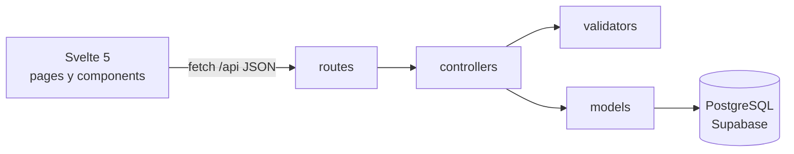

# Rutea EC - Administracion (MVC)

Panel de administracion que alimenta el core de **Rutea EC**: un sistema que arma planes de experiencias locales por ciudad segun las preferencias, el tiempo y el presupuesto del turista, y compara ciudades con un puntaje de aprovechamiento. Este panel carga los datos que el core usa: **experiencias** (precio y duracion), **ciudades** y **regiones**.

Demo desplegada: https://rutea-ec-admin.onrender.com
Autor: Sebastian Parra - Ingeniería Web - UDLA
Video explicativo: _pega aqui el link del video_

## Tecnologia (la misma de Tasky)
- **Backend:** Node.js + Express 5, patron MVC, sesiones con `express-session`
- **Frontend (Vista):** Svelte 5 con Vite, router por hash
- **Base de datos:** PostgreSQL en Supabase (libreria `pg`, consultas parametrizadas)
- **Seguridad:** bcrypt para claves, cookie httpOnly + SameSite, encabezado anti-CSRF, helmet, limite de intentos de login, validacion en el servidor

## Arquitectura


```
backend/
  routes/        que URL llama a que controlador
  controllers/   logica de cada peticion
  models/        acceso a la base de datos
  validators/    validacion de datos sensibles en el servidor
  middleware/    login de admin y proteccion anti-CSRF
  db/            schema.sql y seed.sql
  scripts/       init-db y create-admin
  test/          pruebas del validador
frontend/
  src/pages/     Login, Experiencias, ExperienciaForm, Ciudades
  src/lib/       api.js (fetch) y auth.svelte.js (estado de sesion)
```

## Requisitos del admin y donde se cumplen
1. **Validacion en back-end de datos sensibles:** `backend/validators/experienceValidator.js`. El **precio** (maximo 2 decimales, mayor que 0, hasta 1000 USD) y la **duracion** (15 a 720 minutos, de 15 en 15) se validan en el servidor antes de guardar, porque definen el puntaje de aprovechamiento del core. La base tambien tiene restricciones `CHECK`. Pruebas: `npm test` dentro de `backend`.
2. **Claves foraneas con dropdown, no con input:** al crear una experiencia se elige **Region** y el dropdown de **Ciudad** se llena con las ciudades de esa region (`frontend/src/pages/ExperienciaForm.svelte`, endpoint `GET /api/regions/:id/cities`). El servidor vuelve a comprobar que la ciudad pertenezca a la region (`checkReferences` en `experienceController.js`) aunque alguien manipule la peticion.
3. **Git + deploy:** este repositorio y Render.

## API
| Metodo | Ruta | Descripcion |
|---|---|---|
| POST | /api/auth/login | Iniciar sesion |
| POST | /api/auth/logout | Cerrar sesion |
| GET | /api/auth/me | Sesion actual |
| GET | /api/regions | Regiones |
| GET | /api/regions/:id/cities | Ciudades de una region |
| GET | /api/categories | Categorias |
| GET, POST | /api/experiences | Listar y crear |
| GET, PUT, DELETE | /api/experiences/:id | Ver, editar y borrar |
| GET, POST | /api/cities | Listar y crear |
| DELETE | /api/cities/:id | Borrar ciudad |

Todo excepto login exige sesion de administrador (responde 401 si no).

## Variables de entorno (backend/.env)
| Variable | Para qué sirve |
|---|---|
| DATABASE_URL | Cadena de conexión de Supabase (Session pooler) |
| SESSION_SECRET | Frase larga con la que se firma la sesión |
| PORT | Puerto del servidor (3000 por defecto) |
| ADMIN_EMAIL, ADMIN_PASSWORD | Datos del primer administrador (solo los usa `npm run admin:create`) |

## Correr en tu computador
1. Crear un proyecto en [Supabase](https://supabase.com) y copiar la cadena de conexion (Project Settings > Database > Connection string, Session pooler).
2. En `backend`: `npm install`, copiar `.env.example` a `.env` y completar los valores.
3. `npm run db:init` (crea tablas y datos iniciales) y `npm run admin:create` (crea el admin).
4. Terminal 1, en `backend`: `npm run dev`
5. Terminal 2, en `frontend`: `npm install` y `npm run dev`. Abrir http://localhost:5173

## Deploy en Render
1. New > Web Service > conectar el repositorio.
2. Build command `npm run build`, start command `npm start`, plan Free.
3. Variables: `NODE_ENV=production`, `DATABASE_URL` (la de Supabase), `SESSION_SECRET` (una frase larga).
4. Express sirve la API y tambien el frontend compilado, todo en una sola URL.

Nota: en el plan gratis de Render el servidor se duerme y la sesion se reinicia; hay que volver a ingresar.
